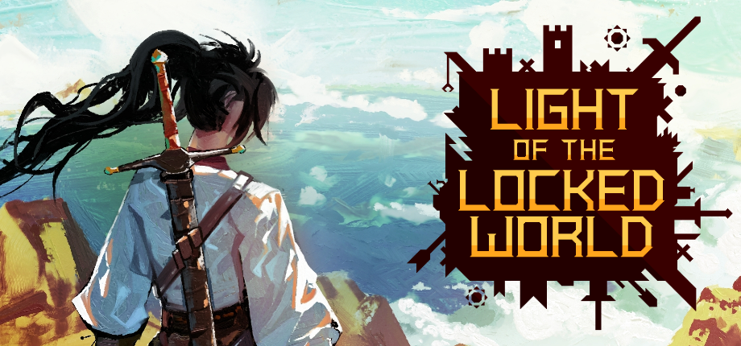

Hi all, I have released a new demo version!

Change list:

* Added manual
* "Crossroads" UI improvements
* Combat short-cuts
* Remapping polishing
* New main menu
* New credits screen
* Origin class perks
* "Immortals" update: New roaming NPCs
* Alchemy vat bug fixes
* Consumables rework
* Small improvements to Moonrise Desert area
* V3663L intro

[Check it out!](https://store.steampowered.com/app/1123690/Light_of_the_Locked_World_Demo/)

Thank you.
